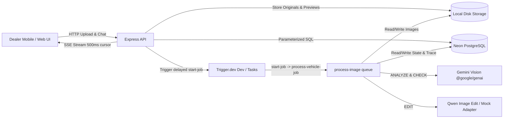

# CarDesk Assistant

CarDesk Assistant is a mobile-first, WhatsApp-style web assistant for used-car dealers. Dealers upload photos of damaged or dirty cars and receive listing-ready repaired photos streamed back image-by-image in near real time.

## Architecture



## Setup

1. **Install dependencies**:
   ```bash
   npm install
   npm --prefix server install
   npm --prefix web install
   ```

2. **Create a Trigger.dev project & get keys**:
   - Go to [cloud.trigger.dev](https://cloud.trigger.dev), create a project (e.g., `ImageCleaningBot`), and copy your Project Ref (`proj_...`) and Development Secret Key (`tr_dev_...`).
   - Note: Trigger.dev Free tier may prompt for a card verification check before running cloud-coordinated dev tasks.

3. **Configure `.env`**:
   Copy `.env.example` to `.env` in the repo root and fill in:
   - `DATABASE_URL` (Neon Postgres connection string)
   - `GEMINI_API_KEY` (Google AI Studio API key)
   - `TRIGGER_SECRET_KEY` and `TRIGGER_PROJECT_REF`
   - `EDIT_PROVIDER=mock` (or `qwen_http` with `EDIT_API_URL` and `EDIT_API_KEY`)

4. **Run migrations and seed default policy**:
   ```bash
   npm run migrate
   npm run seed
   ```

5. **Run the Milestone 0 smoke test**:
   ```bash
   npm run smoke
   ```

6. **Start everything (`web`, `server`, and `trigger.dev dev`)**:
   ```bash
   npm run dev
   ```

## Swapping the Image-Edit Provider

All image editing goes through a single adapter function in [editor.js](file:///d:/ImageCleaningBot/server/src/services/editor.js):
```js
editImage({ imageBuffer, instruction }) -> { imageBuffer, latencyMs, meta }
```
- Set `EDIT_PROVIDER=mock` to overlay a visible `MOCK` badge for local UI development.
- Set `EDIT_PROVIDER=qwen_http` with `EDIT_API_URL`, `EDIT_API_KEY`, and `EDIT_MODEL_NAME` to use a hosted Qwen-Image-Edit multipart endpoint.
- To add another provider (e.g. Fal, Replicate, or OpenAI), add a branch in `editImage()` without touching the pipeline or Trigger.dev tasks.

## Checks & Tests

```bash
npm run check:sql
npm test
```
